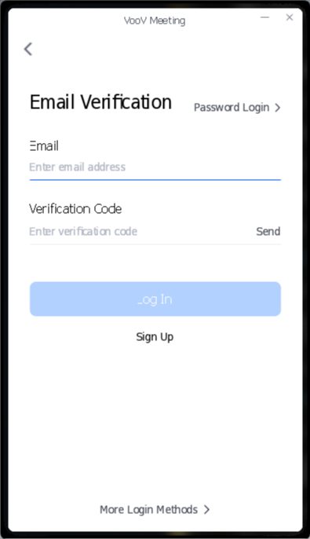

# voov-meeting-linux

An unofficial **Linux build of VooV Meeting** — Tencent's international
video-conferencing client — packaged as `.deb`, `.rpm`, Flatpak and AppImage.

Tencent ships VooV for Windows and macOS, and a Linux client only for the
China-only *Tencent Meeting* product. This project runs **the real VooV
Meeting 3.43.0.510 for Windows** — the same build the official installer
contains — under Wine, with native Linux packaging and desktop integration.
Nothing is re-implemented and no Tencent Meeting binaries are mixed in.

> **Status: 3.43.0.510 (1) — experimental.**
> The client starts, shows the VooV login window and loads the embedded login
> web page (`WeMeetWebCore.dll`). Signing in, joining a meeting, camera,
> microphone and screen sharing have not been verified yet. See
> [Roadmap](#roadmap).


The embedded login page, loaded from VooV's own servers:



## How it works

- The application payload is taken from Tencent's official Windows installer,
  `VooVMeeting_1410000197_3.43.0.510_x86_64.publish.exe`, verified by size,
  MD5 and SHA-256 before it is used.
- VooV 3.43 writes databases and preference files next to its own DLLs. The
  package therefore installs the tree read-only under `/opt/voov-meeting` and
  the launcher copies it into a per-user Wine prefix on first start
  (`~/.local/share/voov-meeting/prefix`). On btrfs/XFS the copy is a reflink,
  so it costs almost no disk space.
- `SLWGA.dll` is a small MIT-licensed stub ([source](src/slwga)) that provides
  the Software Licensing API function Wine does not implement. Without it VooV
  fails at load time.
- The `.deb`, `.rpm` and Arch packages use the distribution's Wine. The
  AppImage and Flatpak bundle Wine 11.22 so they also work on systems without
  one.

## Install

All release builds are attached to
[GitHub Releases](https://github.com/hominluo/voov-meeting-linux/releases).
Pick the format for your distribution.

### Debian / Ubuntu (`.deb`)

```bash
sudo apt install ./voov-meeting_3.43.0.510-1_amd64.deb
voov-meeting
```

### Fedora / RHEL / openSUSE (`.rpm`)

```bash
sudo dnf install ./voov-meeting-3.43.0.510-1.x86_64.rpm
voov-meeting
```

### Any distribution (AppImage)

```bash
chmod +x VooV-Meeting-3.43.0.510-1-x86_64.AppImage
./VooV-Meeting-3.43.0.510-1-x86_64.AppImage
```

The AppImage needs FUSE 2, or run it with `--appimage-extract-and-run`.

### Flatpak

```bash
flatpak install --user ./VooV-Meeting-3.43.0.510-1-x86_64.flatpak
flatpak run com.voovmeeting.VooVMeeting
```

The bundle needs the Freedesktop runtime (`org.freedesktop.Platform//25.08`);
Flatpak downloads it from Flathub on first install.

### Arch Linux

```bash
cd packaging/arch
makepkg -si
```

The PKGBUILD downloads the release `.deb` and installs its contents under
`/opt/voov-meeting`. `wine` is the only runtime dependency.

### First start

The first launch creates the Wine prefix and copies the application into it.
That takes a few seconds and about 1.5 GB of disk space (less with reflinks).
Later launches reuse the copy. Wine runs the client through XWayland on
Wayland sessions.

## Requirements

- x86_64 Linux with glibc, X11 or XWayland.
- Wine 9 or newer (`wine`, or `wine64`, in `PATH`) for the `.deb`, `.rpm`
  and Arch packages (tested with 9.0, 10.0 and 11.22). The AppImage and
  Flatpak include their own Wine.
- A working audio server (PipeWire or PulseAudio) for meetings.

## What is not supported (yet)

- No native Wayland: the window is an XWayland client.
- Screen sharing and camera access under the Flatpak sandbox are untested.
- The updater built into VooV may replace files inside the per-user prefix;
  installing a newer package re-copies the tree but keeps the Wine prefix and
  the login state.
- VooV's own "open in meeting" URL handlers are passed through by the desktop
  file but untested.

## Build from source

Requirements:

- `bash`, `curl`, `tar`, `xz`, `ar`
- ~8 GB free disk space (the app tree is 806 MB and the bundled Wine 746 MB;
  each format stages both before compressing)
- For packaging: `flatpak` + the Freedesktop SDK for Flatpak, Docker for RPM,
  `appimagetool` (downloaded automatically) for AppImage
- Wine for testing (the build itself only needs it for AppImage/Flatpak, where
  the portable build is downloaded automatically)

```bash
git clone https://github.com/hominluo/voov-meeting-linux
cd voov-meeting-linux

# 1. Download + verify the official Windows installer and unpack it
./scripts/prepare.sh

# 2. Build one or all formats into dist/
./scripts/build-deb.sh
./scripts/build-appimage.sh
./scripts/build-flatpak.sh
./scripts/build-rpm.sh
```

`prepare.sh` downloads the installer if it is not in `vendor/` or
`~/Downloads/`, checks its size, MD5 and SHA-256, and unpacks it with 7-Zip
(a standalone copy is downloaded if `7zz`/`7z` is not installed). It is safe
to re-run.

## Versioning

Releases follow the **VooV Meeting product version**, with our own rebuild
counter in parentheses:

- `3.43.0.510 (1)` — first build of VooV 3.43.0.510
- `3.43.0.510 (2)` — our next rebuild of the same product version
- `3.44.0.520 (1)` — new VooV version, counter resets

Git tags and package versions use `3.43.0.510-1` because package managers do
not allow spaces or parentheses. See [RELEASING.md](RELEASING.md).

## Roadmap

- [x] Real VooV Meeting 3.43 application (Windows build) under Wine
- [x] Login window and embedded login web page
- [ ] Verify VooV account login end-to-end
- [ ] Verify joining a meeting, camera, microphone, screen sharing
- [ ] Flatpak screen sharing through the portal

## Legal

The scripts, the `SLWGA.dll` stub and the packaging in this repository are MIT
licensed (see [LICENSE](LICENSE)). The bundled application is proprietary
Tencent software and is **not** covered by the MIT license — see
[NOTICE](NOTICE).

This is an unofficial community project, not affiliated with or supported by
Tencent. VooV Meeting and Tencent Meeting are trademarks of Tencent.
